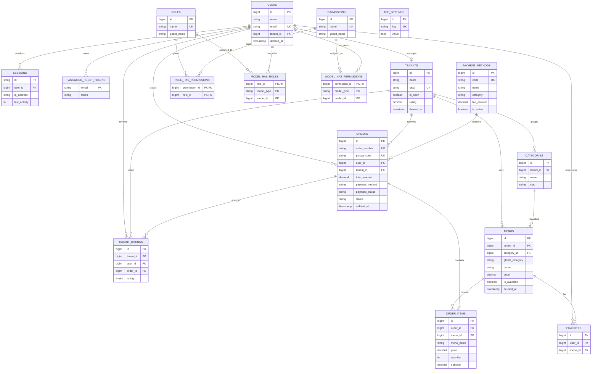
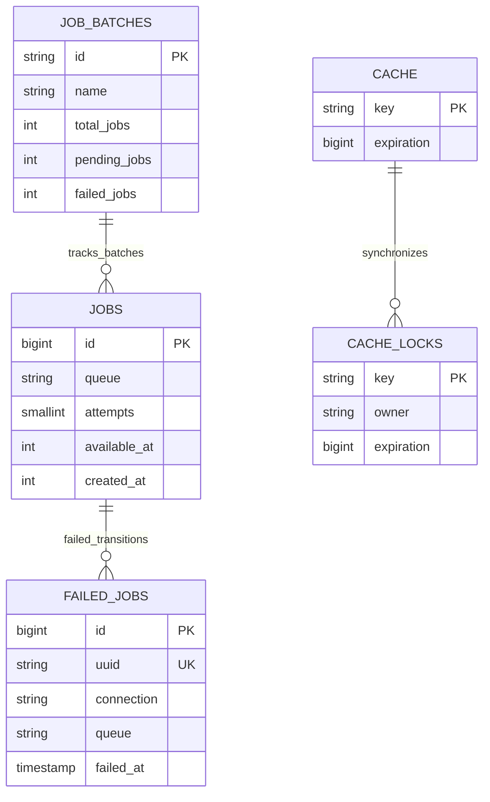

# Data Model & Skema Database Lengkap (Seluruh Tabel Migrasi) — Smart Canteen FEB

Dokumen ini mendefinisikan **seluruh skema basis data secara komprehensif (22 tabel)** yang dihasilkan dari seluruh berkas migrasi database pada sistem **Smart Canteen FEB**, mencakup:
1. **Entitas Domain Bisnis (10 Tabel)**: `users`, `tenants`, `categories`, `menus`, `orders`, `order_items`, `tenant_ratings`, `favorites`, `payment_methods`, `app_settings`
2. **Sistem Akses & Peran Spatie RBAC (5 Tabel)**: `roles`, `permissions`, `model_has_roles`, `model_has_permissions`, `role_has_permissions`
3. **Infrastruktur Autentikasi & Sesi Laravel (2 Tabel)**: `password_reset_tokens`, `sessions`
4. **Infrastruktur Asynchronous Queue & Background Jobs (3 Tabel)**: `jobs`, `job_batches`, `failed_jobs`
5. **Infrastruktur Cache & Distributed Locking (2 Tabel)**: `cache`, `cache_locks`

---

## 1. Daftar & Taksonomi Tabel Migrasi

Berikut adalah pemetaan seluruh 22 tabel basis data yang didefinisikan dalam migrasi Laravel:

| No | Nama Tabel | Kategori Modul | File Sumber Migrasi | Keterangan Singkat |
| :-: | :--- | :--- | :--- | :--- |
| 1 | `users` | Domain / Auth | `0001_01_01_000000`, `2025_08_14_170933`, `2026_09_19_072844` | Pengguna sistem (Mahasiswa, Tenant, Admin), 2FA, dan Soft Deletes |
| 2 | `tenants` | Domain Bisnis | `2026_09_19_072843`, `2026_09_20_030000` | Profil stand/kantin, jam buka, rating akumulatif, Soft Deletes |
| 3 | `categories` | Domain Bisnis | `2026_09_19_072845` | Kategori menu internal per stand tenant |
| 4 | `menus` | Domain Bisnis | `2026_09_19_072846`, `2026_09_19_182534`, `2026_09_20_040000` | Menu hidangan, kategori global, varian JSON, promo, Soft Deletes |
| 5 | `orders` | Domain Bisnis | `2026_09_19_072847`, `2026_09_20_070000`, `2026_09_20_080000` | Transaksi pesanan, breakdown biaya, kode QR, token Snap, status alur |
| 6 | `order_items` | Domain Bisnis | `2026_09_19_072848`, `2026_09_20_070000` | Rincian item pesanan, snapshot nama & harga menu, varian JSON |
| 7 | `tenant_ratings` | Domain Bisnis | `2026_09_20_030001` | Ulasan & penilaian bintang (1-5) dari mahasiswa kepada tenant |
| 8 | `favorites` | Domain Bisnis | `2026_09_21_140000` | Daftar menu favorit (bookmark) per pengguna |
| 9 | `payment_methods`| Domain Bisnis | `2026_09_20_060000` | Master data opsi pembayaran (bank transfer, e-wallet, admin fee) |
| 10 | `app_settings` | Domain Bisnis | `2026_09_20_060001` | Konfigurasi parameter global aplikasi & biaya layanan |
| 11 | `roles` | Spatie RBAC | `2026_09_18_131157` | Definisi peran otoritas (`student`, `tenant`, `admin`) |
| 12 | `permissions` | Spatie RBAC | `2026_09_18_131157` | Definisi hak akses spesifik per guard |
| 13 | `model_has_roles`| Spatie RBAC | `2026_09_18_131157` | Pivot polimorfik relasi user/model dengan peran (roles) |
| 14 | `model_has_permissions` | Spatie RBAC | `2026_09_18_131157` | Pivot polimorfik relasi user/model dengan hak akses langsung |
| 15 | `role_has_permissions` | Spatie RBAC | `2026_09_18_131157` | Pivot relasi many-to-many hak akses yang melekat pada peran |
| 16 | `password_reset_tokens` | Laravel Core | `0001_01_01_000000` | Penyimpanan token permintaan lupa/reset kata sandi |
| 17 | `sessions` | Laravel Core | `0001_01_01_000000` | Session driver database untuk melacak aktivitas login & IP |
| 18 | `jobs` | Laravel Queue | `0001_01_01_000002` | Antrean eksekusi background tasks (notifikasi, webhook) |
| 19 | `job_batches` | Laravel Queue | `0001_01_01_000002` | Pelacakan pemrosesan batch antrean pekerjaan |
| 20 | `failed_jobs` | Laravel Queue | `0001_01_01_000002` | Log pengecualian dan payload tugas antrean yang gagal |
| 21 | `cache` | Laravel Cache | `0001_01_01_000001` | Cache driver database untuk performa query berulang |
| 22 | `cache_locks` | Laravel Cache | `0001_01_01_000001` | Mekanisme atomic locks untuk mencegah race conditions |

---

## 2. Entity Relationship Diagram (ERD) Lengkap & Rapat

Agar diagram tetap **rapat, proporsional, dan mudah dibaca**, entitas ditampilkan secara ringkas berbasis **Key Columns (PK, FK, UK, dan Kolom Status/Identitas Utama)** tanpa membebani visual dengan audit timestamps (spesifikasi kolom 100% lengkap tersedia di Bab 3).

### 2.1 ERD Terpadu: Domain Bisnis, Autentikasi & Spatie RBAC (17 Tabel)

Diagram di bawah ini merangkum seluruh tabel domain yang saling berelasi aktif secara terpadu dan rapat:

---

### 2.2 ERD Infrastruktur: Background Jobs & Cache Engine (5 Tabel)

Diagram terpisah untuk tabel-tabel infrastruktur asinkron dan caching agar visualisasi tetap rapat dan tidak mengaburkan model relasional bisnis:

---

## 3. Spesifikasi Detail Seluruh 22 Tabel

### 3.1 Modul Domain & Bisnis

#### 1. `users`
*Tabel utama akun pengguna sistem (Mahasiswa, Pemilik Tenant, Admin) beserta proteksi 2FA dan Soft Deletes.*
* **Migrasi**: `0001_01_01_000000_create_users_table.php`, `2025_08_14_170933_add_two_factor_columns_to_users_table.php`, `2026_09_19_072844_add_tenant_and_soft_deletes_to_users_table.php`

| Nama Kolom | Tipe Data | Nullable | Default | Keterangan & Batasan |
| :--- | :--- | :---: | :---: | :--- |
| `id` | `BIGINT UNSIGNED` | ❌ | *Auto-inc* | **PRIMARY KEY** |
| `name` | `VARCHAR(255)` | ❌ | - | Nama lengkap pengguna |
| `email` | `VARCHAR(255)` | ❌ | - | **UNIQUE**, alamat email untuk login |
| `email_verified_at` | `TIMESTAMP` | ✔️ | `NULL` | Waktu verifikasi email |
| `password` | `VARCHAR(255)` | ❌ | - | Hash kata sandi pengguna (Bcrypt / Argon2) |
| `tenant_id` | `BIGINT UNSIGNED` | ✔️ | `NULL` | **FOREIGN KEY** `tenants(id)` `ON DELETE SET NULL`. Relasi jika pengguna adalah pemilik stand |
| `two_factor_secret` | `TEXT` | ✔️ | `NULL` | Secret key terenkripsi untuk Google Authenticator / TOTP |
| `two_factor_recovery_codes` | `TEXT` | ✔️ | `NULL` | Kumpulan kode pemulihan darurat 2FA |
| `two_factor_confirmed_at` | `TIMESTAMP` | ✔️ | `NULL` | Waktu konfirmasi aktivasi 2FA |
| `remember_token` | `VARCHAR(100)` | ✔️ | `NULL` | Token sesi login otomatis (*Remember Me*) |
| `deleted_at` | `TIMESTAMP` | ✔️ | `NULL` | Timestamp **Soft Delete** (menjaga riwayat pesanan historis) |
| `created_at` | `TIMESTAMP` | ✔️ | `NULL` | Waktu pembuatan akun |
| `updated_at` | `TIMESTAMP` | ✔️ | `NULL` | Waktu pembaruan data akun |

---

#### 2. `tenants`
*Menyimpan entitas profil stand/warung kantin di FEB.*
* **Migrasi**: `2026_09_19_072843_create_tenants_table.php`, `2026_09_20_030000_add_extended_attributes_to_tenants_table.php`

| Nama Kolom | Tipe Data | Nullable | Default | Keterangan & Batasan |
| :--- | :--- | :---: | :---: | :--- |
| `id` | `BIGINT UNSIGNED` | ❌ | *Auto-inc* | **PRIMARY KEY** |
| `name` | `VARCHAR(255)` | ❌ | - | Nama nama stand kantin |
| `slug` | `VARCHAR(255)` | ❌ | - | **UNIQUE**, slug URL ramah SEO (cth: `kantin-kejujuran-feb`) |
| `description` | `TEXT` | ✔️ | `NULL` | Deskripsi singkat mengenai hidangan stand |
| `image` | `VARCHAR(255)` | ✔️ | `NULL` | Path foto utama profil stand |
| `banner_image` | `VARCHAR(255)` | ✔️ | `NULL` | Path gambar banner header stand |
| `logo_image` | `VARCHAR(255)` | ✔️ | `NULL` | Path gambar avatar/logo stand |
| `phone` | `VARCHAR(255)` | ✔️ | `NULL` | Nomor telepon/WhatsApp pengelola stand |
| `opening_hours` | `VARCHAR(255)` | ✔️ | `'08:00 - 17:00'` | Informasi jam operasional stand |
| `is_active` | `TINYINT(1)` | ❌ | `1` (`true`) | Status aktif stand dalam sistem |
| `is_open` | `TINYINT(1)` | ❌ | `1` (`true`) | Status real-time buka/tutup stand menerima pesanan |
| `rating` | `DECIMAL(3,2)` | ❌ | `5.00` | Nilai rating rata-rata (skala 1.00 – 5.00) |
| `reviews_count` | `INT UNSIGNED` | ❌ | `0` | Jumlah akumulatif ulasan yang diterima |
| `deleted_at` | `TIMESTAMP` | ✔️ | `NULL` | Timestamp **Soft Delete** |
| `created_at` | `TIMESTAMP` | ✔️ | `NULL` | Waktu pendaftaran stand |
| `updated_at` | `TIMESTAMP` | ✔️ | `NULL` | Waktu pembaruan stand |

---

#### 3. `categories`
*Kategori menu lokal/internal yang dikelola sendiri oleh masing-masing tenant.*
* **Migrasi**: `2026_09_19_072845_create_categories_table.php`

| Nama Kolom | Tipe Data | Nullable | Default | Keterangan & Batasan |
| :--- | :--- | :---: | :---: | :--- |
| `id` | `BIGINT UNSIGNED` | ❌ | *Auto-inc* | **PRIMARY KEY** |
| `tenant_id` | `BIGINT UNSIGNED` | ❌ | - | **FOREIGN KEY** `tenants(id)` `ON DELETE CASCADE` |
| `name` | `VARCHAR(255)` | ❌ | - | Nama kategori (cth: *Makanan Berat*, *Minuman Dingin*) |
| `slug` | `VARCHAR(255)` | ❌ | - | Slug kategori internal |
| `created_at` | `TIMESTAMP` | ✔️ | `NULL` | Waktu pembuatan |
| `updated_at` | `TIMESTAMP` | ✔️ | `NULL` | Waktu pembaruan |

* **Indeks Unik Komposit**: `UNIQUE (tenant_id, slug)`

---

#### 4. `menus`
*Katalog makanan dan minuman yang dijual oleh stand kantin.*
* **Migrasi**: `2026_09_19_072846_create_menus_table.php`, `2026_09_19_182534_add_rich_attributes_to_menus_table.php`, `2026_09_20_040000_add_global_category_to_menus_table.php`

| Nama Kolom | Tipe Data | Nullable | Default | Keterangan & Batasan |
| :--- | :--- | :---: | :---: | :--- |
| `id` | `BIGINT UNSIGNED` | ❌ | *Auto-inc* | **PRIMARY KEY** |
| `tenant_id` | `BIGINT UNSIGNED` | ❌ | - | **FOREIGN KEY** `tenants(id)` `ON DELETE CASCADE` |
| `category_id` | `BIGINT UNSIGNED` | ✔️ | `NULL` | **FOREIGN KEY** `categories(id)` `ON DELETE SET NULL` |
| `global_category` | `VARCHAR(255)` | ❌ | `'makanan'` | Kategori universal untuk filter katalog (`makanan`, `minuman`, `camilan`) |
| `name` | `VARCHAR(255)` | ❌ | - | Nama hidangan |
| `description` | `TEXT` | ✔️ | `NULL` | Deskripsi komposisi dan rasa |
| `price` | `DECIMAL(12,2)` | ❌ | - | Harga jual saat ini (Rp) |
| `original_price` | `DECIMAL(12,2)` | ✔️ | `NULL` | Harga asli sebelum promo/diskon (Rp) |
| `image` | `VARCHAR(255)` | ✔️ | `NULL` | Path foto hidangan |
| `is_available` | `TINYINT(1)` | ❌ | `1` (`true`) | Ketersediaan stok (*Available* vs *Habis*) |
| `is_recommended` | `TINYINT(1)` | ❌ | `0` (`false`) | Penanda menu andalan / *Best Seller* |
| `estimated_time` | `INT` | ❌ | `15` | Estimasi durasi masak/penyajian dalam menit |
| `options` | `JSON` | ✔️ | `NULL` | Varian opsi menu (topping, level kepedasan, es batu) |
| `deleted_at` | `TIMESTAMP` | ✔️ | `NULL` | Timestamp **Soft Delete** |
| `created_at` | `TIMESTAMP` | ✔️ | `NULL` | Waktu dibuat |
| `updated_at` | `TIMESTAMP` | ✔️ | `NULL` | Waktu diperbarui |

---

#### 5. `orders`
*Tabel transaksi pesanan utama mahasiswa ke tenant.*
* **Migrasi**: `2026_09_19_072847_create_orders_table.php`, `2026_09_20_070000_add_checkout_attributes_to_orders_table.php`, `2026_09_20_080000_add_payment_details_to_orders_table.php`

| Nama Kolom | Tipe Data | Nullable | Default | Keterangan & Batasan |
| :--- | :--- | :---: | :---: | :--- |
| `id` | `BIGINT UNSIGNED` | ❌ | *Auto-inc* | **PRIMARY KEY** |
| `order_number` | `VARCHAR(255)` | ❌ | - | **UNIQUE**, nomor invoice sistem (cth: `SC-20261015-0012`) |
| `pickup_code` | `VARCHAR(255)` | ❌ | - | **UNIQUE**, kode verifikasi pengambilan & bayar cash (cth: `FEB-8921`) |
| `user_id` | `BIGINT UNSIGNED` | ❌ | - | **FOREIGN KEY** `users(id)` `ON DELETE CASCADE` (Mahasiswa) |
| `tenant_id` | `BIGINT UNSIGNED` | ❌ | - | **FOREIGN KEY** `tenants(id)` `ON DELETE CASCADE` (Tenant) |
| `subtotal_amount` | `DECIMAL(12,2)` | ❌ | `0.00` | Subtotal penjumlahan seluruh item belanja (Rp) |
| `app_fee` | `DECIMAL(12,2)` | ❌ | `0.00` | Biaya layanan aplikasi Smart Canteen (Rp) |
| `channel_fee` | `DECIMAL(12,2)` | ❌ | `0.00` | Biaya gateway / admin pembayaran (Rp) |
| `total_amount` | `DECIMAL(12,2)` | ❌ | - | Total akhir tagihan pembayaran (Rp) |
| `payment_method` | `VARCHAR(255)` | ❌ | `'cashless'` | Metode utama: `'cashless'` (Midtrans) atau `'cash'` (Tunai di Stand) |
| `payment_channel_code` | `VARCHAR(255)` | ✔️ | `NULL` | Saluran spesifik (cth: `bca_va`, `qris`, `gopay`, `cash`) |
| `payment_details` | `JSON` | ✔️ | `NULL` | Detail payload respons pembayaran gateway / QR |
| `dining_option` | `VARCHAR(255)` | ❌ | `'dine_in'` | Opsi penyajian: `'dine_in'` (Makan di Tempat) atau `'takeaway'` (Bungkus) |
| `payment_status` | `VARCHAR(255)` | ❌ | `'unpaid'` | Status pembayaran: `'unpaid'`, `'paid'`, `'failed'`, `'expired'` |
| `status` | `VARCHAR(255)` | ❌ | `'pending'` | Status progres pesanan: `'pending'`, `'paid'`, `'processing'`, `'ready'`, `'completed'`, `'failed'` |
| `snap_token` | `VARCHAR(255)` | ✔️ | `NULL` | Token transaksi Midtrans Snap untuk modal checkout |
| `notes` | `TEXT` | ✔️ | `NULL` | Catatan umum dari mahasiswa untuk keseluruhan pesanan |
| `paid_at` | `TIMESTAMP` | ✔️ | `NULL` | Timestamp saat pembayaran lunas diverifikasi |
| `processing_at` | `TIMESTAMP` | ✔️ | `NULL` | Timestamp saat tenant mulai memasak/menyiapkan |
| `ready_at` | `TIMESTAMP` | ✔️ | `NULL` | Timestamp saat pesanan siap di-pickup |
| `completed_at` | `TIMESTAMP` | ✔️ | `NULL` | Timestamp saat pesanan diambil & transaksi tuntas |
| `deleted_at` | `TIMESTAMP` | ✔️ | `NULL` | Timestamp **Soft Delete** |
| `created_at` | `TIMESTAMP` | ✔️ | `NULL` | Waktu pesanan dibuat |
| `updated_at` | `TIMESTAMP` | ✔️ | `NULL` | Waktu status diperbarui |

---

#### 6. `order_items`
*Rincian hidangan di dalam pesanan dengan mekanisme **Snapshot Data**.*
* **Migrasi**: `2026_09_19_072848_create_order_items_table.php`, `2026_09_20_070000_add_checkout_attributes_to_orders_table.php`

| Nama Kolom | Tipe Data | Nullable | Default | Keterangan & Batasan |
| :--- | :--- | :---: | :---: | :--- |
| `id` | `BIGINT UNSIGNED` | ❌ | *Auto-inc* | **PRIMARY KEY** |
| `order_id` | `BIGINT UNSIGNED` | ❌ | - | **FOREIGN KEY** `orders(id)` `ON DELETE CASCADE` |
| `menu_id` | `BIGINT UNSIGNED` | ✔️ | `NULL` | **FOREIGN KEY** `menus(id)` `ON DELETE SET NULL` |
| `menu_name` | `VARCHAR(255)` | ❌ | - | **Snapshot Nama Menu** (tidak berubah bila menu diubah/dihapus) |
| `price` | `DECIMAL(12,2)` | ❌ | - | **Snapshot Harga Satuan** saat transaksi terjadi (Rp) |
| `quantity` | `INT UNSIGNED` | ❌ | - | Kuantitas porsi yang dipesan |
| `options` | `JSON` | ✔️ | `NULL` | **Snapshot Opsi Varian** yang dipilih pembeli |
| `note` | `TEXT` | ✔️ | `NULL` | Catatan khusus item ini (cth: *"Jangan pakai daun bawang"*) |
| `subtotal` | `DECIMAL(12,2)` | ❌ | - | Hasil kalkulasi `price * quantity` (Rp) |
| `created_at` | `TIMESTAMP` | ✔️ | `NULL` | Waktu pencatatan item |
| `updated_at` | `TIMESTAMP` | ✔️ | `NULL` | Waktu pembaruan item |

---

#### 7. `tenant_ratings`
*Ulasan dan penilaian bintang (1-5 ⭐) untuk stand kantin.*
* **Migrasi**: `2026_09_20_030001_create_tenant_ratings_table.php`

| Nama Kolom | Tipe Data | Nullable | Default | Keterangan & Batasan |
| :--- | :--- | :---: | :---: | :--- |
| `id` | `BIGINT UNSIGNED` | ❌ | *Auto-inc* | **PRIMARY KEY** |
| `tenant_id` | `BIGINT UNSIGNED` | ❌ | - | **FOREIGN KEY** `tenants(id)` `ON DELETE CASCADE` |
| `user_id` | `BIGINT UNSIGNED` | ❌ | - | **FOREIGN KEY** `users(id)` `ON DELETE CASCADE` (Penilai) |
| `order_id` | `BIGINT UNSIGNED` | ✔️ | `NULL` | **FOREIGN KEY** `orders(id)` `ON DELETE SET NULL` (Pesanan terkait) |
| `rating` | `TINYINT UNSIGNED` | ❌ | `5` | Nilai skor ulasan (skala integer 1 – 5) |
| `comment` | `TEXT` | ✔️ | `NULL` | Testimoni tertulis mengenai rasa/layanan |
| `created_at` | `TIMESTAMP` | ✔️ | `NULL` | Waktu ulasan dikirim |
| `updated_at` | `TIMESTAMP` | ✔️ | `NULL` | Waktu ulasan disunting |

---

#### 8. `favorites`
*Menyimpan daftar bookmark hidangan favorit mahasiswa.*
* **Migrasi**: `2026_09_21_140000_create_favorites_table.php`

| Nama Kolom | Tipe Data | Nullable | Default | Keterangan & Batasan |
| :--- | :--- | :---: | :---: | :--- |
| `id` | `BIGINT UNSIGNED` | ❌ | *Auto-inc* | **PRIMARY KEY** |
| `user_id` | `BIGINT UNSIGNED` | ❌ | - | **FOREIGN KEY** `users(id)` `ON DELETE CASCADE` |
| `menu_id` | `BIGINT UNSIGNED` | ❌ | - | **FOREIGN KEY** `menus(id)` `ON DELETE CASCADE` |
| `created_at` | `TIMESTAMP` | ✔️ | `NULL` | Waktu bookmark ditambahkan |
| `updated_at` | `TIMESTAMP` | ✔️ | `NULL` | Waktu bookmark diperbarui |

* **Indeks Unik Komposit**: `UNIQUE (user_id, menu_id)`

---

#### 9. `payment_methods`
*Master data konfigurasi saluran pembayaran dan besaran biaya admin.*
* **Migrasi**: `2026_09_20_060000_create_payment_methods_table.php`

| Nama Kolom | Tipe Data | Nullable | Default | Keterangan & Batasan |
| :--- | :--- | :---: | :---: | :--- |
| `id` | `BIGINT UNSIGNED` | ❌ | *Auto-inc* | **PRIMARY KEY** |
| `code` | `VARCHAR(255)` | ❌ | - | **UNIQUE**, kode unik saluran (cth: `bca_va`, `qris`, `cash`) |
| `name` | `VARCHAR(255)` | ❌ | - | Label nama tampilan (cth: *BCA Virtual Account*) |
| `category` | `ENUM` | ❌ | `'bank_transfer'` | Kategori opsi: `'bank_transfer'` atau `'ewallet'` |
| `logo` | `VARCHAR(255)` | ✔️ | `NULL` | Path logo ikon saluran pembayaran |
| `fee_type` | `ENUM` | ❌ | `'fixed'` | Tipe perhitungan admin fee: `'fixed'` (Nominal) atau `'percentage'` (%) |
| `fee_amount` | `DECIMAL(10,2)` | ❌ | `0.00` | Besaran biaya layanan saluran |
| `is_active` | `TINYINT(1)` | ❌ | `0` (`false`) | Status aktif saluran untuk dipilih di kasir |
| `created_at` | `TIMESTAMP` | ✔️ | `NULL` | Waktu dibuat |
| `updated_at` | `TIMESTAMP` | ✔️ | `NULL` | Waktu diperbarui |

---

#### 10. `app_settings`
*Konfigurasi parameter global dan nilai dinamis aplikasi.*
* **Migrasi**: `2026_09_20_060001_create_app_settings_table.php`

| Nama Kolom | Tipe Data | Nullable | Default | Keterangan & Batasan |
| :--- | :--- | :---: | :---: | :--- |
| `id` | `BIGINT UNSIGNED` | ❌ | *Auto-inc* | **PRIMARY KEY** |
| `key` | `VARCHAR(255)` | ❌ | - | **UNIQUE**, kunci konfigurasi (cth: `app_fee`, `midtrans_mode`) |
| `value` | `TEXT` | ✔️ | `NULL` | Nilai data pengaturan |
| `label` | `VARCHAR(255)` | ✔️ | `NULL` | Deskripsi singkat label pengaturan untuk UI admin |
| `created_at` | `TIMESTAMP` | ✔️ | `NULL` | Waktu pencatatan |
| `updated_at` | `TIMESTAMP` | ✔️ | `NULL` | Waktu pembaruan |

---

### 3.2 Modul Akses & Peran (Spatie Laravel Permission)

Seluruh tabel RBAC ini dihasilkan dari berkas migrasi: `2026_09_18_131157_create_permission_tables.php`.

#### 11. `roles`
*Definisi peran otoritas pengguna dalam aplikasi.*

| Nama Kolom | Tipe Data | Nullable | Default | Keterangan & Batasan |
| :--- | :--- | :---: | :---: | :--- |
| `id` | `BIGINT UNSIGNED` | ❌ | *Auto-inc* | **PRIMARY KEY** |
| `name` | `VARCHAR(255)` | ❌ | - | Nama peran: `'student'`, `'tenant'`, `'admin'` |
| `guard_name` | `VARCHAR(255)` | ❌ | - | Guard autentikasi Laravel (biasanya `'web'`) |
| `created_at` | `TIMESTAMP` | ✔️ | `NULL` | Waktu dibuat |
| `updated_at` | `TIMESTAMP` | ✔️ | `NULL` | Waktu diperbarui |

* **Indeks Unik Komposit**: `UNIQUE (name, guard_name)`

---

#### 12. `permissions`
*Definisi hak izin spesifik fitur.*

| Nama Kolom | Tipe Data | Nullable | Default | Keterangan & Batasan |
| :--- | :--- | :---: | :---: | :--- |
| `id` | `BIGINT UNSIGNED` | ❌ | *Auto-inc* | **PRIMARY KEY** |
| `name` | `VARCHAR(255)` | ❌ | - | Nama hak izin (cth: `manage-tenants`, `verify-cash-order`) |
| `guard_name` | `VARCHAR(255)` | ❌ | - | Guard autentikasi (biasanya `'web'`) |
| `created_at` | `TIMESTAMP` | ✔️ | `NULL` | Waktu dibuat |
| `updated_at` | `TIMESTAMP` | ✔️ | `NULL` | Waktu diperbarui |

* **Indeks Unik Komposit**: `UNIQUE (name, guard_name)`

---

#### 13. `model_has_roles`
*Pivot polimorfik penghubung entitas model (pengguna) dengan peran.*

| Nama Kolom | Tipe Data | Nullable | Default | Keterangan & Batasan |
| :--- | :--- | :---: | :---: | :--- |
| `role_id` | `BIGINT UNSIGNED` | ❌ | - | **FOREIGN KEY** `roles(id)` `ON DELETE CASCADE` |
| `model_type` | `VARCHAR(255)` | ❌ | - | Class namespace model (cth: `App\Models\User`) |
| `model_id` | `BIGINT UNSIGNED` | ❌ | - | ID entitas model (`users.id`) |

* **PRIMARY KEY Komposit**: `(role_id, model_id, model_type)`
* **Indeks Komposit**: `INDEX (model_id, model_type)`

---

#### 14. `model_has_permissions`
*Pivot polimorfik untuk pemberian izin langsung ke model tanpa melalui peran.*

| Nama Kolom | Tipe Data | Nullable | Default | Keterangan & Batasan |
| :--- | :--- | :---: | :---: | :--- |
| `permission_id` | `BIGINT UNSIGNED` | ❌ | - | **FOREIGN KEY** `permissions(id)` `ON DELETE CASCADE` |
| `model_type` | `VARCHAR(255)` | ❌ | - | Class namespace model (cth: `App\Models\User`) |
| `model_id` | `BIGINT UNSIGNED` | ❌ | - | ID entitas model (`users.id`) |

* **PRIMARY KEY Komposit**: `(permission_id, model_id, model_type)`
* **Indeks Komposit**: `INDEX (model_id, model_type)`

---

#### 15. `role_has_permissions`
*Pivot relasi many-to-many hak izin yang diberikan kepada suatu peran.*

| Nama Kolom | Tipe Data | Nullable | Default | Keterangan & Batasan |
| :--- | :--- | :---: | :---: | :--- |
| `permission_id` | `BIGINT UNSIGNED` | ❌ | - | **FOREIGN KEY** `permissions(id)` `ON DELETE CASCADE` |
| `role_id` | `BIGINT UNSIGNED` | ❌ | - | **FOREIGN KEY** `roles(id)` `ON DELETE CASCADE` |

* **PRIMARY KEY Komposit**: `(permission_id, role_id)`

---

### 3.3 Modul Infrastruktur Autentikasi & Sesi (Laravel Core)

Didefinisikan dalam berkas migrasi: `0001_01_01_000000_create_users_table.php`.

#### 16. `password_reset_tokens`
*Penyimpanan token aman untuk alur reset kata sandi.*

| Nama Kolom | Tipe Data | Nullable | Default | Keterangan & Batasan |
| :--- | :--- | :---: | :---: | :--- |
| `email` | `VARCHAR(255)` | ❌ | - | **PRIMARY KEY**, email penerima link reset |
| `token` | `VARCHAR(255)` | ❌ | - | Token reset ter-hash |
| `created_at` | `TIMESTAMP` | ✔️ | `NULL` | Waktu token dibuat |

---

#### 17. `sessions`
*Driver sesi database Laravel untuk melacak sesi aktif, IP address, dan perangkat pengguna.*

| Nama Kolom | Tipe Data | Nullable | Default | Keterangan & Batasan |
| :--- | :--- | :---: | :---: | :--- |
| `id` | `VARCHAR(255)` | ❌ | - | **PRIMARY KEY**, string identifier sesi acak |
| `user_id` | `BIGINT UNSIGNED` | ✔️ | `NULL` | **INDEX**, ID pengguna pemilik sesi jika telah login |
| `ip_address` | `VARCHAR(45)` | ✔️ | `NULL` | Alamat IPv4 atau IPv6 pengunjung |
| `user_agent` | `TEXT` | ✔️ | `NULL` | String User-Agent browser/perangkat |
| `payload` | `LONGTEXT` | ❌ | - | Data serialisasi sesi Laravel |
| `last_activity` | `INT` | ❌ | - | **INDEX**, Unix timestamp aktivitas terakhir |

---

### 3.4 Modul Antrean & Background Jobs (Laravel Queue)

Didefinisikan dalam berkas migrasi: `0001_01_01_000002_create_jobs_table.php`. Digunakan saat `QUEUE_CONNECTION=database`.

#### 18. `jobs`
*Menyimpan pekerjaan antrean asinkron (cth: pengiriman notifikasi, sinkronisasi webhook Midtrans).*

| Nama Kolom | Tipe Data | Nullable | Default | Keterangan & Batasan |
| :--- | :--- | :---: | :---: | :--- |
| `id` | `BIGINT UNSIGNED` | ❌ | *Auto-inc* | **PRIMARY KEY** |
| `queue` | `VARCHAR(255)` | ❌ | - | **INDEX**, nama channel antrean (cth: `'default'`, `'notifications'`) |
| `payload` | `LONGTEXT` | ❌ | - | Payload serialisasi serialized command job |
| `attempts` | `SMALLINT UNSIGNED`| ❌ | - | Jumlah percobaan eksekusi yang telah dilakukan |
| `reserved_at` | `INT UNSIGNED` | ✔️ | `NULL` | Unix timestamp saat worker mengunci job |
| `available_at` | `INT UNSIGNED` | ❌ | - | Unix timestamp saat job siap dijalankan |
| `created_at` | `INT UNSIGNED` | ❌ | - | Unix timestamp saat job dimasukkan ke antrean |

---

#### 19. `job_batches`
*Mengelola eksekusi tugas antrean yang dijalankan secara batch.*

| Nama Kolom | Tipe Data | Nullable | Default | Keterangan & Batasan |
| :--- | :--- | :---: | :---: | :--- |
| `id` | `VARCHAR(255)` | ❌ | - | **PRIMARY KEY**, UUID unik identifier batch |
| `name` | `VARCHAR(255)` | ❌ | - | Nama batch pekerjaan |
| `total_jobs` | `INT` | ❌ | - | Total jumlah job dalam batch |
| `pending_jobs` | `INT` | ❌ | - | Jumlah job yang belum selesai |
| `failed_jobs` | `INT` | ❌ | - | Jumlah job yang gagal dieksekusi |
| `failed_job_ids` | `LONGTEXT` | ❌ | - | Array JSON berisi daftar ID job yang gagal |
| `options` | `MEDIUMTEXT` | ✔️ | `NULL` | Konfigurasi serialisasi batch |
| `cancelled_at` | `INT` | ✔️ | `NULL` | Unix timestamp jika batch dibatalkan |
| `created_at` | `INT` | ❌ | - | Unix timestamp pembuatan batch |
| `finished_at` | `INT` | ✔️ | `NULL` | Unix timestamp penyelesaian seluruh job |

---

#### 20. `failed_jobs`
*Log permanen untuk tugas antrean yang mengalami kegagalan/error fatal.*

| Nama Kolom | Tipe Data | Nullable | Default | Keterangan & Batasan |
| :--- | :--- | :---: | :---: | :--- |
| `id` | `BIGINT UNSIGNED` | ❌ | *Auto-inc* | **PRIMARY KEY** |
| `uuid` | `VARCHAR(255)` | ❌ | - | **UNIQUE**, identifier UUID unik job yang gagal |
| `connection` | `VARCHAR(255)` | ❌ | - | Nama koneksi database queue |
| `queue` | `VARCHAR(255)` | ❌ | - | Nama antrean tempat job berjalan |
| `payload` | `LONGTEXT` | ❌ | - | Data payload job asli |
| `exception` | `LONGTEXT` | ❌ | - | Stack trace error dan pesan exception PHP |
| `failed_at` | `TIMESTAMP` | ❌ | `CURRENT_TIMESTAMP` | Waktu kegagalan terjadi |

* **Indeks Komposit**: `INDEX (connection, queue, failed_at)`

---

### 3.5 Modul Cache & Distributed Locking (Laravel Cache)

Didefinisikan dalam berkas migrasi: `0001_01_01_000001_create_cache_table.php`. Digunakan saat `CACHE_STORE=database`.

#### 21. `cache`
*Penyimpanan key-value cache aplikasi pada level database.*

| Nama Kolom | Tipe Data | Nullable | Default | Keterangan & Batasan |
| :--- | :--- | :---: | :---: | :--- |
| `key` | `VARCHAR(255)` | ❌ | - | **PRIMARY KEY**, identifier unik cache key |
| `value` | `MEDIUMTEXT` | ❌ | - | Nilai cache yang telah diserialisasi |
| `expiration` | `BIGINT` | ❌ | - | **INDEX**, Unix timestamp waktu kedaluwarsa cache |

---

#### 22. `cache_locks`
*Atomic lock mechanism untuk sinkronisasi race condition (misal saat checkout simultan atau verifikasi QR ganda).*

| Nama Kolom | Tipe Data | Nullable | Default | Keterangan & Batasan |
| :--- | :--- | :---: | :---: | :--- |
| `key` | `VARCHAR(255)` | ❌ | - | **PRIMARY KEY**, nama identifier kunci atomik |
| `owner` | `VARCHAR(255)` | ❌ | - | Identifier proses/token pemilik lock |
| `expiration` | `BIGINT` | ❌ | - | **INDEX**, Unix timestamp kedaluwarsa lock |

---

## 4. Prinsip Integritas Data & Desain Lanjutan

### 4.1 Kebijakan Soft Deletes (`deleted_at`)
Sistem mengadopsi mekanisme penghapusan aman (*Soft Deletes*) pada entitas penting:
1. `users`: Jika akun mahasiswa/tenant dinonaktifkan, seluruh riwayat order tetap utuh dan invoice historis dapat dibuka.
2. `tenants`: Jika stand kantin tutup atau berhenti beroperasi, data laporan pembukuan dan statistik masa lalu tidak terputus.
3. `menus`: Jika penjual menghapus menu hidangan dari daftar jualan, pesanan terdahulu yang pernah memuat menu tersebut tetap valid.
4. `orders`: Pesanan yang dibatalkan tidak dihapus permanen dari basis data, memungkinkan audit keuangan yang transparan.

### 4.2 Snapshot Pattern pada `order_items`
Tabel `order_items` menyimpan snapshot independen:
- `menu_name`: Menjaga nama menu pada saat pembelian.
- `price`: Menyimpan nominal harga saat transaksi dibayar, sehingga jika tenant menaikkan harga hidangan di kemudian hari, total belanja pesanan lama tidak akan berubah.
- `options`: Menyimpan pilihan varian saat transaksi dibuat dalam format JSON.
- `menu_id` memiliki constraint `ON DELETE SET NULL`, memastikan integritas relasional jika referensi fisik menu dihapus permanen.

### 4.3 Desain Composite Unique Key
Untuk menjamin integritas data tingkat relasional tanpa dependensi logic aplikasi:
- `categories`: `UNIQUE (tenant_id, slug)` — menjamin bahwa nama slug kategori tidak boleh duplikat di stand yang sama, namun stand yang berbeda diperbolehkan memiliki nama slug yang sama.
- `favorites`: `UNIQUE (user_id, menu_id)` — mencegah bookmark duplikat untuk menu yang sama oleh pengguna yang sama.
- `roles` & `permissions`: `UNIQUE (name, guard_name)` — memastikan nama peran dan izin unik per guard autentikasi.
