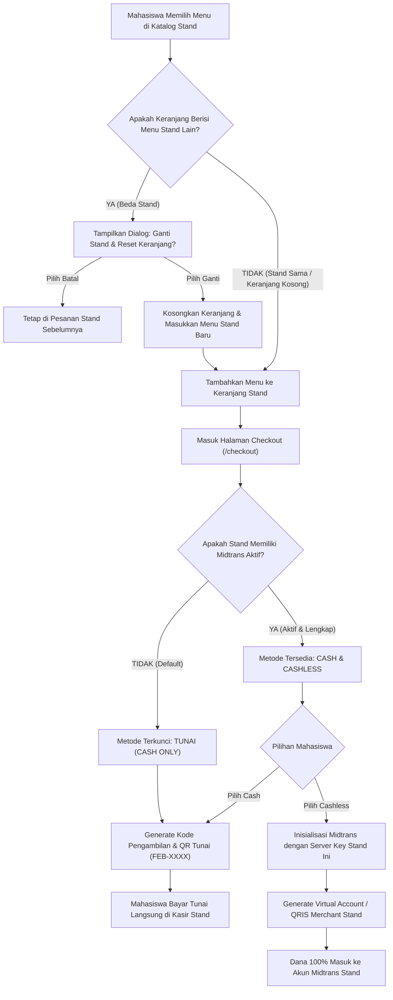
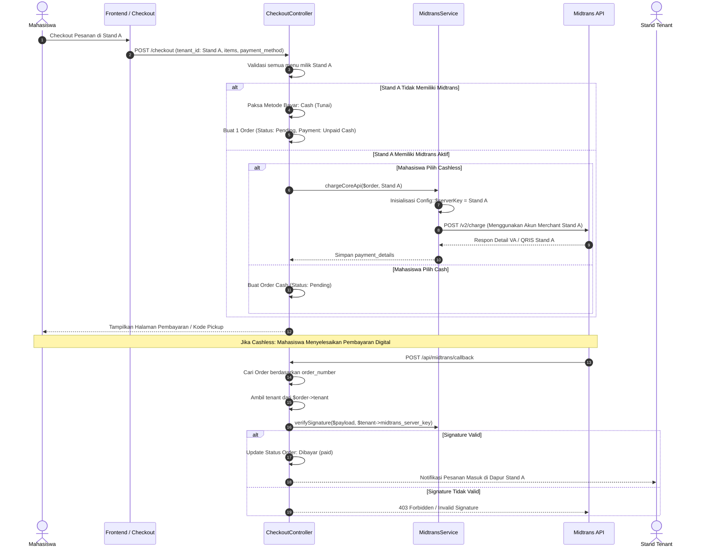
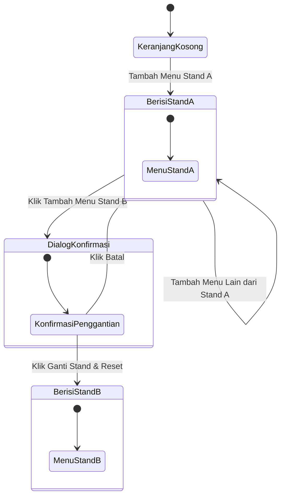

# Perubahan Arsitektur: Multi-Tenant Midtrans & Fallback Tunai (Cash) — Smart Canteen FEB

Dokumen ini mendefinisikan secara menyeluruh **spesifikasi teknis, rancangan basis data, alur bisnis, serta peta perubahan sistem** untuk mendukung fitur **Multi-Tenant Midtrans Gateway**, di mana setiap toko/stand dapat memiliki akun Midtrans independen secara opsional, dengan fallback default ke **Tunai (Cash)** jika konfigurasi Midtrans kosong.

---

## 1. Latar Belakang & Analisis Kebutuhan

### 1.1 Kondisi Sistem Saat Ini (Global Midtrans Single-Account)
Pada arsitektur awal, sistem Smart Canteen FEB menggunakan **1 akun Midtrans global** yang dikonfigurasi melalui `.env` dan tabel `app_settings` (`midtrans.server_key` & `midtrans.client_key`):
- Seluruh dana pembayaran digital dari semua stand masuk ke satu rekening penampung (rekening kampus/fakultas).
- Pengelola harus melakukan rekonsiliasi manual dan pencairan (*disbursement*) berkala ke masing-masing penjual kantin.
- Stand tidak memiliki kontrol atas akun Midtrans mereka sendiri.

### 1.2 Kebutuhan Baru (Per-Tenant Midtrans dengan Fallback Cash)
1. **Setiap Stand Punya Akun Midtrans Sendiri (Opsional)**:
   - Penjual yang telah memiliki akun merchant Midtrans terverifikasi dapat memasukkan *Server Key*, *Client Key*, dan *Merchant ID* langsung pada dashboard pengaturan stand mereka (`/tenant/settings`).
   - Dana hasil transaksi cashless langsung masuk ke akun Midtrans masing-masing tenant tanpa perantara.
2. **Default Tunai (Cash) jika Settingan Kosong**:
   - Jika stand belum mendaftar Midtrans, belum mengisi API Key, atau sengaja menonaktifkan fitur cashless, stand tersebut **otomatis hanya melayani pembayaran Tunai (Cash)**.
   - Sistem tidak boleh error ketika API Key kosong; sistem secara elegan menyembunyikan opsi cashless untuk stand tersebut dan mengalihkan mahasiswa ke pembayaran Cash.
3. **Penghapusan Multi-Stand Checkout (Adopsi Standar Single-Tenant Cart seperti ShopeeFood / GoFood)**:
   - Keranjang belanja dibatasi secara ketat hanya menampung menu dari **1 stand kantin per transaksi**.
   - Menghilangkan kerumitan split-order, konflik multi-gateway, dan kebingungan pembayaran campuran.
   - Jika stand di keranjang memiliki Midtrans: mahasiswa dapat memilih **Cashless** atau **Cash**.
   - Jika stand di keranjang tidak memiliki Midtrans: checkout **otomatis dan eksklusif menggunakan Cash (Tunai di Stand)**.

---

## 2. Analisis Dampak Perubahan Sistem (Impact Matrix)

Perubahan ini memiliki dampak arsitektural yang luas pada beberapa layer aplikasi:

| Komponen | Status Saat Ini | Rencana Perubahan Baru | Tingkat Perubahan |
| :--- | :--- | :--- | :---: |
| **Kebijakan Keranjang (Cart Policy)** | Mendukung pengelompokan item multi-stand (`itemsByTenant`). | **Disederhanakan menjadi Single-Tenant Cart** (seperti ShopeeFood/GoFood). Jika ganti stand, muncul konfirmasi reset keranjang. | **Tinggi (Menyederhanakan Sistem)** |
| **Tabel `tenants`** | Hanya menyimpan profil fisik (nama, slug, banner, jam buka). | Tambah kolom: `midtrans_merchant_id`, `midtrans_client_key`, `midtrans_server_key`, `midtrans_is_production`, `midtrans_is_active`. | **Tinggi (Migrasi Baru)** |
| **Model `Tenant`** | Tidak ada atribut kredensial. | Tambah fillable, cast enkripsi (`encrypted`), dan helper `hasActiveMidtrans()`. | **Sedang** |
| **Tabel `orders`** | Sudah memiliki `tenant_id`. | Tidak perlu diubah. 1 Order = 1 Tenant = 1 Checkout. Sangat bersih dan kompatibel. | **Tidak Berubah (Stabil)** |
| **`MidtransService`** | Membaca config static di `__construct()`. | Refactor menjadi **Dynamic Configuration per Tenant** sebelum eksekusi SDK. | **Tinggi** |
| **Webhook Callback** | Memverifikasi signature menggunakan global `server_key`. | Dynamic Signature Verification berdasarkan tenant pemilik order (`$order->tenant->midtrans_server_key`). | **Tinggi** |
| **`CheckoutController`** | Loop multi-order per tenant (`foreach $itemsByTenant`). | **Disederhanakan drastis**: Validasi 1 tenant tunggal. Jika stand tidak punya Midtrans, kunci metode ke Cash. | **Tinggi (Lebih Bersih)** |
| **Tenant Settings Page** | Form profil stand biasa. | Tambah Card/Tab **Integrasi Pembayaran Digital (Midtrans)** dengan proteksi input mask. | **Sedang** |
| **Checkout UI (Customer)** | Mengelompokkan item per stand di satu halaman checkout. | Tampilan checkout 1 stand fokus. Deteksi otomatis kapabilitas stand (Cash vs Cashless). | **Sedang** |

---

## 3. Skema Basis Data & Rencana Migrasi

### 3.1 Migrasi Baru: `add_midtrans_credentials_to_tenants_table.php`

Penambahan kolom konfigurasi Midtrans pada tabel `tenants`:

```php
<?php

use Illuminate\Database\Migrations\Migration;
use Illuminate\Database\Schema\Blueprint;
use Illuminate\Support\Facades\Schema;

return new class extends Migration
{
    /**
     * Run the migrations.
     */
    public function up(): void
    {
        Schema::table('tenants', function (Blueprint $table) {
            $table->string('midtrans_merchant_id')->nullable()->after('opening_hours');
            $table->string('midtrans_client_key')->nullable()->after('midtrans_merchant_id');
            $table->text('midtrans_server_key')->nullable()->after('midtrans_client_key');
            $table->boolean('midtrans_is_production')->default(false)->after('midtrans_server_key');
            $table->boolean('midtrans_is_active')->default(false)->after('midtrans_is_production');
        });
    }

    /**
     * Reverse the migrations.
     */
    public function down(): void
    {
        Schema::table('tenants', function (Blueprint $table) {
            $table->dropColumn([
                'midtrans_merchant_id',
                'midtrans_client_key',
                'midtrans_server_key',
                'midtrans_is_production',
                'midtrans_is_active',
            ]);
        });
    }
};
```

### 3.2 Detail Spesifikasi Kolom Baru

| Nama Kolom | Tipe Data | Nullable | Default | Keterangan Teknis |
| :--- | :--- | :---: | :---: | :--- |
| `midtrans_merchant_id` | `VARCHAR(255)` | ✔️ | `NULL` | ID Merchant Midtrans toko (cth: `G123456789`) |
| `midtrans_client_key` | `VARCHAR(255)` | ✔️ | `NULL` | Public Client Key untuk inisialisasi frontend Snap JS |
| `midtrans_server_key` | `TEXT` | ✔️ | `NULL` | Secret Server Key (Wajib dienkripsi menggunakan `encrypted` cast di Eloquent) |
| `midtrans_is_production` | `BOOLEAN` | ❌ | `false` | Environment: `false` = Sandbox (Testing), `true` = Production |
| `midtrans_is_active` | `BOOLEAN` | ❌ | `false` | Master toggle: jika `false`, toko hanya menerima pembayaran tunai |

### 3.3 Penyesuaian Model `App\Models\Tenant`

```php
// Tambahan casts & helper di app/Models/Tenant.php
protected function casts(): array
{
    return [
        'is_active' => 'boolean',
        'is_open' => 'boolean',
        'midtrans_is_production' => 'boolean',
        'midtrans_is_active' => 'boolean',
        'midtrans_server_key' => 'encrypted', // Enkripsi tingkat kolom (AES-256)
    ];
}

/**
 * Cek apakah stand memiliki konfigurasi Midtrans yang lengkap & aktif.
 */
public function hasActiveMidtrans(): bool
{
    return (bool) (
        $this->midtrans_is_active &&
        !empty($this->midtrans_server_key) &&
        !empty($this->midtrans_client_key)
    );
}
```

---

## 4. Alur Kerja & Diagram Arsitektur (Mermaid)

### 4.1 Decision Tree: Penentuan Opsi Pembayaran di Checkout



---

### 4.2 Alur Transaksi Cashless Stand & Webhook Callback



---

## 5. Penghapusan Multi-Stand Checkout: Adopsi Single-Tenant Cart (Standar ShopeeFood / GoFood)

### 5.1 Alasan Rasional Penghapusan Multi-Stand Checkout
Fitur multi-stand checkout (memesan dari beberapa kantin berbeda sekaligus dalam satu kali bayar) sengaja **ditiadakan/dihapus** karena alasan fundamental berikut:

1. **Standar Industri Food Delivery (ShopeeFood / GoFood / GrabFood)**:
   Bahkan platform raksasa seperti ShopeeFood dan GoFood tidak pernah mengizinkan pengguna memesan dari dua restoran berbeda dalam satu keranjang belanja. Hal ini demi kepastian pesanan, antrean dapur yang terisolasi, dan akurasi pembayaran.
2. **Eliminasi Konflik Metode Pembayaran**:
   Pada sistem multi-stand, jika Stand A menerima QRIS sedangkan Stand B hanya tunai, pengguna akan menghadapi skenario *hybrid payment* yang membingungkan: separuh tagihan dibayar online, separuh tunai di kasir terpisah. Dengan **Single-Tenant Cart**, skenario ini lenyap 100%.
3. **Penyederhanaan Arsitektur Database & Backend**:
   - Tepat **1 Transaksi Checkout = 1 Order = 1 Tenant**.
   - Tidak ada lagi loop pembuatan order berganda (`foreach $itemsByTenant`), tidak ada multi-redirect, dan tidak ada partial failure (Stand A sukses bayar tapi Stand B gagal).
4. **Kepastian Operasional Self-Pickup di Lapangan**:
   Mahasiswa hanya memegang **1 Kode Pengambilan (`pickup_code`)** untuk mendatangi stand yang bersangkutan, tanpa risiko pesanan di stand kedua terabaikan.

---

### 5.2 Mekanisme Single-Tenant Cart di Frontend

Alur interaksi penambahan menu diatur sebagai berikut:



#### Tampilan Modal Konfirmasi:
```
┌─────────────────────────────────────────────────────────────┐
│ ⚠️ Ganti Stand Kantin?                                      │
├─────────────────────────────────────────────────────────────┤
│ Keranjang Anda saat ini berisi menu dari "Kantin Bu Siti".  │
│ Menambahkan menu dari "Kopi Kenangan" akan mengosongkan     │
│ keranjang belanja Anda sebelumnya.                         │
│                                                             │
│ [ Batal ]          [ Ya, Ganti Stand & Kosongkan Keranjang ]│
└─────────────────────────────────────────────────────────────┘
```

---

### 5.3 Dampak pada Logika Opsi Pembayaran Checkout

Karena keranjang hanya berisi menu dari **1 stand tunggal**, penentuan opsi pembayaran di halaman `/checkout` menjadi sangat sederhana, deterministik, dan bebas bug:

1. **Jika Stand Tersebut Belum Mengisi Midtrans (Default)**:
   - Radio button metode pembayaran otomatis terkunci pada **"💵 Tunai di Stand (Cash)"**.
   - Opsi Cashless disembunyikan atau dinonaktifkan dengan badge keterangan:
     *ℹ️ "Stand ini saat ini hanya menerima pembayaran Tunai langsung di kasir stand."*
   - Tidak akan pernah terjadi error koneksi ke gateway Midtrans.
2. **Jika Stand Tersebut Memiliki Midtrans Aktif**:
   - Mahasiswa bebas memilih antara **Cashless (QRIS / Virtual Account)** atau **Tunai di Stand (Cash)**.
   - Jika memilih Cashless, dana langsung dialirkan ke akun Midtrans milik stand tersebut.

---

## 6. Perubahan Kode & Logika Teknis (Implementation Guide)

### 6.1 Refactor `App\Services\MidtransService`
Saat ini Midtrans SDK menggunakan konfigurasi static. Service harus dimodifikasi agar dapat menerima entitas `Tenant` sebelum setiap pemanggilan API:

```php
namespace App\Services;

use App\Models\Order;
use App\Models\Tenant;
use Midtrans\Config;
use Midtrans\CoreApi;
use Midtrans\Snap;
use Exception;

class MidtransService
{
    /**
     * Konfigurasi SDK Midtrans secara dinamis untuk tenant tertentu.
     */
    public function configureForTenant(Tenant $tenant): void
    {
        if (!$tenant->hasActiveMidtrans()) {
            throw new Exception("Stand '{$tenant->name}' belum mengaktifkan pembayaran digital Midtrans.");
        }

        Config::$serverKey = $tenant->midtrans_server_key;
        Config::$clientKey = $tenant->midtrans_client_key;
        Config::$isProduction = (bool) $tenant->midtrans_is_production;
        Config::$isSanitized = true;
        Config::$is3ds = true;
    }

    /**
     * Eksekusi charge dengan kredensial stand terkait.
     */
    public function chargeCoreApi(Order $order, string $channelCode): array
    {
        $tenant = $order->tenant;
        $this->configureForTenant($tenant);

        // Alur pembentukan payload params (order_id, gross_amount, customer_details)...
        // CoreApi::charge($params) akan otomatis menggunakan serverKey milik stand
    }

    /**
     * Validasi Signature Webhook menggunakan Server Key milik stand pemilik order.
     */
    public function verifyNotification(array $payload, Tenant $tenant): bool
    {
        $orderId = $payload['order_id'] ?? '';
        $statusCode = $payload['status_code'] ?? '';
        $grossAmount = $payload['gross_amount'] ?? '';
        $signatureKey = $payload['signature_key'] ?? '';

        $localSignature = hash('sha512', $orderId . $statusCode . $grossAmount . $tenant->midtrans_server_key);

        return hash_equals($localSignature, $signatureKey);
    }
}
```

---

### 6.2 Penyesuaian `App\Http\Controllers\Api\MidtransCallbackController`
Webhook controller perlu memuat data tenant dari order sebelum memvalidasi signature:

```php
public function handleCallback(Request $request, MidtransService $midtransService): JsonResponse
{
    $payload = $request->all();
    $orderNumber = $payload['order_id'] ?? null;

    $order = Order::with('tenant')->where('order_number', $orderNumber)->first();

    if (!$order || !$order->tenant) {
        return response()->json(['message' => 'Order atau Tenant tidak ditemukan'], 404);
    }

    $tenant = $order->tenant;

    // Verifikasi signature menggunakan kunci tenant
    if (!$midtransService->verifyNotification($payload, $tenant)) {
        return response()->json(['message' => 'Invalid signature key untuk tenant ini'], 403);
    }

    // Proses pembaruan status order ke Paid...
    $midtransService->markOrderAsPaid($order);

    return response()->json(['message' => 'Notifikasi Midtrans tenant berhasil diproses']);
}
```

---

### 6.3 Halaman Pengaturan Stand (`/tenant/settings`)
Pada antarmuka pengelola stand, ditambahkan formulir konfigurasi Midtrans:
1. **Saklar Aktifkan Cashless**: Switch toggle on/off.
2. **Pilihan Mode**: Dropdown `Sandbox (Demo / Uji Coba)` vs `Production (Live)`.
3. **Merchant ID**: Input text.
4. **Client Key**: Input text.
5. **Server Key**: Input password dengan tombol show/hide (otomatis terenkripsi saat disimpan).
6. **Kotak Info Panduan**:
   > *"Jika kunci Midtrans dibiarkan kosong, stand Anda akan secara otomatis beroperasi dalam mode **Tunai (Cash)**. Pembeli akan diarahkan membayar di kasir menggunakan Scan QR/Kode Pengambilan."*

---

### 6.4 Penyederhanaan `App\Http\Controllers\Customer\CheckoutController`
Dengan adopsi Single-Tenant Cart, loop `$itemsByTenant` yang rumit dapat dihapus sepenuhnya. Setiap request checkout hanya menghasilkan **1 Order tunggal**:

```php
public function store(Request $request, MidtransService $midtransService): JsonResponse
{
    $validated = $request->validate([
        'tenant_id' => ['required', 'exists:tenants,id'],
        'items' => ['required', 'array', 'min:1'],
        'items.*.menu_id' => ['required', 'exists:menus,id'],
        'items.*.qty' => ['required', 'integer', 'min:1'],
        'items.*.price' => ['required', 'numeric', 'min:0'],
        'items.*.choices' => ['nullable', 'array'],
        'items.*.note' => ['nullable', 'string', 'max:255'],
        'payment_method' => ['required', 'in:cashless,cash'],
        'payment_channel_code' => ['nullable', 'string'],
        'dining_option' => ['required', 'in:dine_in,takeaway'],
        'notes' => ['nullable', 'string', 'max:500'],
    ]);

    $user = $request->user();
    $tenant = Tenant::findOrFail($validated['tenant_id']);

    // Validasi toko sedang beroperasi
    if (!$tenant->is_active || !$tenant->is_open) {
        return response()->json(['message' => "Stand '{$tenant->name}' sedang tutup."], 422);
    }

    // Validasi integritas metode pembayaran stand
    if ($validated['payment_method'] === 'cashless' && !$tenant->hasActiveMidtrans()) {
        return response()->json([
            'message' => "Stand '{$tenant->name}' hanya melayani pembayaran Tunai (Cash). Silakan pilih Tunai.",
        ], 422);
    }

    // Buat 1 Order tunggal secara instan & bersih
    $order = DB::transaction(function () use ($validated, $user, $tenant) {
        // Kalkulasi subtotal & app fee
        // Simpan 1 Order & rincian OrderItem...
        return $order;
    });

    // Jika cashless, langsung request Snap/Core API ke Midtrans stand ini
    if ($validated['payment_method'] === 'cashless') {
        $paymentDetails = $midtransService->chargeCoreApi($order, $validated['payment_channel_code'] ?? 'qris');
        $order->update(['payment_details' => $paymentDetails]);
    }

    return response()->json([
        'order_id' => $order->id,
        'order_number' => $order->order_number,
        'redirect_url' => route('orders.payment', $order->id),
    ]);
}
```

---

## 7. Keamanan & Proteksi Kredensial

1. **Enkripsi Data At-Rest**:
   - Kolom `midtrans_server_key` **wajib** menggunakan Eloquent cast `'encrypted'`. Kunci disimpan dalam bentuk ciphertext di database MySQL menggunakan kunci enkripsi `APP_KEY`.
2. **Masking Kredensial di Frontend**:
   - Saat mengirimkan data tenant ke Inertia React di `/tenant/settings`, nilai `midtrans_server_key` tidak boleh dikirimkan secara mentah. Tampilkan hanya 4 karakter terakhir (misal: `SB-Mid-server-••••••••-Ab12`).
3. **Pencegahan Webhook Spoofing**:
   - Karena setiap stand memiliki `server_key` berbeda, penyerang tidak dapat memalsukan notifikasi stand A menggunakan key stand B.
4. **Isolasi Merchant**:
   - Dana transaksi stand A masuk 100% ke saldo akun Midtrans pemilik stand A, mematuhi regulasi pemisahan dana pihak ketiga.

---

## 8. Rencana Implementasi Bertahap (Rollout Roadmap)

| Tahap | Aktivitas Utama | Output |
| :---: | :--- | :--- |
| **Fase 1** | Buat berkas migrasi penambahan kolom Midtrans di tabel `tenants`. | Kolom baru siap di database, default bernilai `NULL` / `false`. |
| **Fase 2** | Update Model `Tenant` dengan casts enkripsi dan helper method `hasActiveMidtrans()`. | Enkripsi otomatis saat simpan Server Key. |
| **Fase 3** | Refactor `MidtransService` untuk mendukung konfigurasi dinamis per tenant. | Dukungan multi-server-key tanpa konflik static state. |
| **Fase 4** | Update `MidtransCallbackController` untuk memverifikasi signature berbasis stand terkait. | Webhook aman terisolasi per stand. |
| **Fase 5** | Update `CheckoutController` dan UI Checkout untuk logika fallback Cash otomatis jika stand belum mengisi Midtrans. | UX checkout dinamis & anti-error. |
| **Fase 6** | Buat UI Formulir Pengaturan Midtrans di `/tenant/settings`. | Penjual dapat menginput key mereka sendiri. |
| **Fase 7** | Pengujian integrasi simulasi (Tenant A Cashless via Simulator Midtrans vs Tenant B Tunai di Stand). | Validasi end-to-end sukses. |

---

## 9. Kompatibilitas Mundur (Backward Compatibility)

Perubahan ini dirancang agar **tidak merusak (non-breaking)** fungsionalitas yang ada:
- **Tenant Lama / Default Seeder**: Stand yang ada saat ini secara default memiliki kolom Midtrans bernilai `NULL` dan `midtrans_is_active = false`.
- **Perilaku Otomatis**: Stand tersebut langsung beralih ke mode **Tunai (Cash)** tanpa memerlukan konfigurasi tambahan, sehingga seluruh skenario demo cash tetap berjalan 100% normal.
- **Transisi Mulus**: Begitu penjual memasukkan API Key, opsi cashless langsung terbuka secara real-time bagi pembeli stand tersebut.
